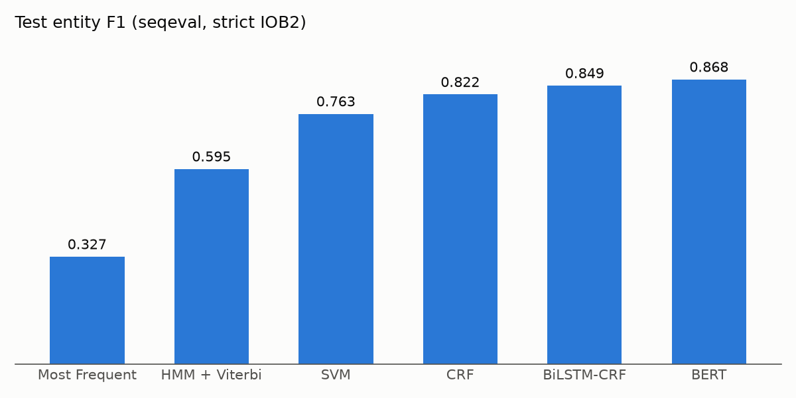
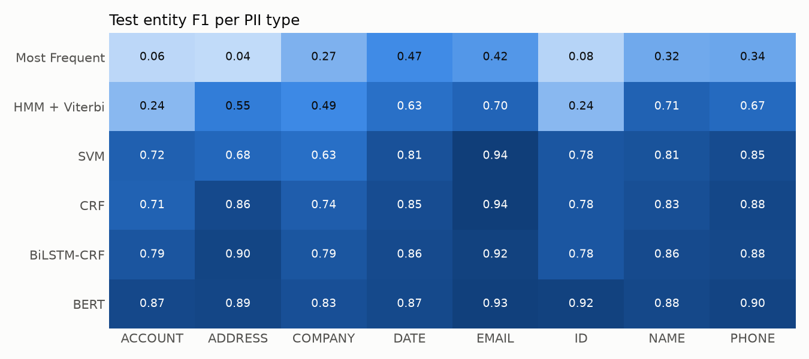
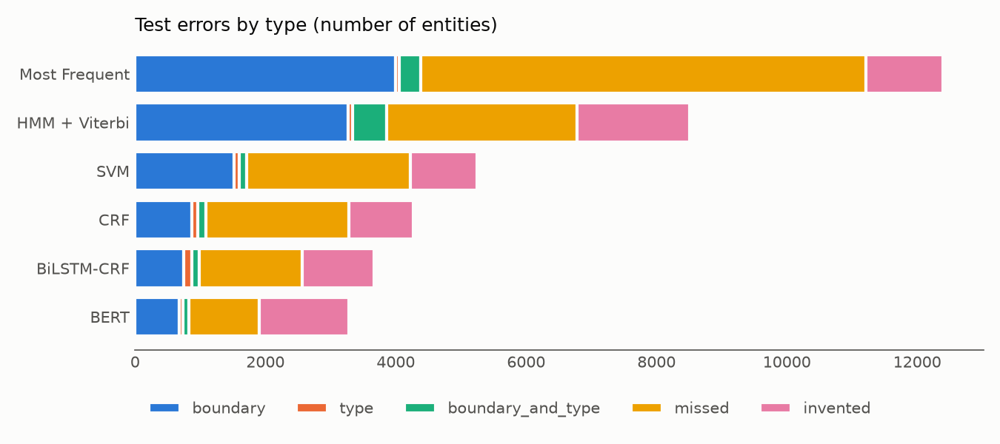

# PII Detection in Financial Documents

COE025 Project 2. We find personal data (PII) in synthetic financial documents (invoices,
contracts, bank messages, insurance forms, SWIFT and EDI messages...) and label its type.
The task is sequence labeling with BIO tags: every word gets one tag, as in the course's
"Sequence Labeling for Part of Speech and Named Entities" lecture.

```
Please  send  to  Anna    Schmidt  on  12      March   2024    ,  IBAN  DE89       3704 ...
O       O     O   B-NAME  I-NAME   O   B-DATE  I-DATE  I-DATE  O  O     B-ACCOUNT  I-ACCOUNT ...
```

Two things make it hard, matching the two NER difficulties from the lecture:

- **Segmentation:** addresses and dates span several words, and IBANs are split by spaces.
  The model has to find where each entity starts and ends.
- **Type ambiguity:** a number can be a customer ID or an account number, and "Morgan" can
  be a person or a company. Context decides.

We compare one model from each algorithm family in the lecture, plus an SVM, against a
fine-tuned BERT. All models use the same data and are scored by the same script.

## Data

- **Source:** [`gretelai/synthetic_pii_finance_multilingual`](https://huggingface.co/datasets/gretelai/synthetic_pii_finance_multilingual)
  (Apache-2.0), English documents only.
- **Cleaning:** `dataset/prepare_dataset.py` validates the character spans, removes
  duplicates, short documents and documents without PII, splits text into words, converts
  spans to BIO tags, cuts long documents into chunks of at most 200 words and splits the
  data by document. Every step and its counts are in `dataset/data/REPORT.md`.
- **Labels:** 8 PII types, 17 BIO tags (`dataset/data/labels.json`).

| Type | Source types |
|---|---|
| NAME | name, first_name |
| COMPANY | company |
| ADDRESS | street_address |
| DATE | date, date_of_birth, time |
| EMAIL | email |
| PHONE | phone_number |
| ACCOUNT | iban, bban, swift_bic_code, credit_card_number, credit_card_security_code, account_pin |
| ID | customer_id, ssn, driver_license_number and other identifiers |

| Split | Chunks | Source |
|---|---:|---|
| train | 30,545 | Gretel train split |
| val | 3,389 | 10% of Gretel train, by document (seed 42) |
| test | 3,903 | Gretel test split |

## Models

Architecture and specific model are listed separately, as the course asks.

| # | Role | Architecture | Specific model | Folder |
|---|---|---|---|---|
| 1 | baseline | Most frequent tag | Each word gets the tag it had most often in train; unknown words get O | `baselines/` |
| 2 | baseline | HMM | First-order HMM, add-k smoothing, word-shape classes for rare words, our own Viterbi (NumPy) | `baselines/` |
| 3 | baseline | SVM | `LinearSVC` (scikit-learn), window and word-shape features | `svm_crf/` |
| 4 | baseline | CRF | `sklearn-crfsuite` (L-BFGS), same features as the SVM plus tag transitions | `svm_crf/` |
| 5 | baseline | BiLSTM-CRF | GloVe 100d + character CNN + 2-layer BiLSTM (128) + CRF (`pytorch-crf`) | `bilstm_crf/` |
| 6 | main model | BERT (transformer encoder) | `bert-base-cased` fine-tuned for token classification | `bert/` |

What each model can use, following the three information sources from the lecture:

| Model | Word-tag probability | Neighboring words / tags | Word shape |
|---|---|---|---|
| Most frequent | yes | no | no |
| HMM | yes | tag transitions | only for rare and unseen words (shape classes) |
| SVM | as a feature | ±2 word window, no tag dependency | hand-written features |
| CRF | as a feature | ±2 word window and tag transitions | hand-written features |
| BiLSTM-CRF | learned | whole sentence (BiLSTM) and tag transitions | learned (character CNN) |
| BERT | learned | whole chunk (attention) | learned (subwords, case) |

Published models: [BERT](https://huggingface.co/akifkulll/finance-pii-bert-base-cased),
[SVM](https://huggingface.co/elifsudayi/svm-ner), [CRF](https://huggingface.co/elifsudayi/crf-ner).

## Metric

- **Ranking metric: entity-level micro F1** with seqeval in strict IOB2 mode. An entity is
  correct only if both its boundaries and its type are right, so the metric measures both
  difficulties above at once.
- **Token accuracy is reported but not used for ranking.** About 92% of words are `O`, so a
  model that finds little PII still gets high accuracy (see the most frequent baseline below).
- **Missed PII rate** (1 − recall): missing personal data is worse than masking a bit too
  much.
- **F1 per type** and **error types** (boundary, type, boundary and type, missed, invented)
  show where each model fails.

`benchmark/evaluate.py` computes all of these from the prediction files. No model's own
metric is used in the final comparison.

## Results (test split)

All numbers below are computed by `benchmark/run_benchmark.py` with the shared evaluation
(seqeval, strict IOB2) on the test split. Full tables for val and test, and the charts, are in
`benchmark/results/`.

| Model | Precision | Recall | Entity F1 | Macro F1 | Token accuracy | Missed PII |
|---|---:|---:|---:|---:|---:|---:|
| Most frequent | 0.397 | 0.279 | 0.327 | 0.251 | 0.949 | 72.1% |
| HMM + Viterbi | 0.630 | 0.564 | 0.595 | 0.528 | 0.960 | 43.6% |
| SVM | 0.802 | 0.728 | 0.763 | 0.780 | 0.980 | 27.2% |
| CRF | 0.859 | 0.789 | 0.822 | 0.825 | 0.981 | 21.1% |
| BiLSTM-CRF | **0.864** | 0.835 | 0.849 | 0.847 | 0.985 | 16.5% |
| **BERT** | 0.860 | **0.877** | **0.868** | **0.885** | **0.987** | **12.3%** |



Entity F1 per type:

| Model | ACCOUNT | ADDRESS | COMPANY | DATE | EMAIL | ID | NAME | PHONE |
|---|---:|---:|---:|---:|---:|---:|---:|---:|
| Most frequent | 0.060 | 0.041 | 0.274 | 0.474 | 0.417 | 0.082 | 0.320 | 0.338 |
| HMM + Viterbi | 0.236 | 0.553 | 0.487 | 0.628 | 0.699 | 0.236 | 0.713 | 0.668 |
| SVM | 0.725 | 0.682 | 0.633 | 0.813 | 0.940 | 0.784 | 0.808 | 0.854 |
| CRF | 0.714 | 0.864 | 0.740 | 0.846 | 0.941 | 0.784 | 0.831 | 0.881 |
| BiLSTM-CRF | 0.789 | 0.895 | 0.789 | 0.862 | 0.918 | 0.783 | 0.862 | 0.876 |
| BERT | 0.874 | 0.889 | 0.825 | 0.869 | 0.927 | 0.918 | 0.877 | 0.900 |



Error types (number of test entities). Each wrong gold entity is a boundary error (right
type, wrong span), a type error (right span, wrong type), both, or missed; a predicted entity
that overlaps no gold entity is invented.

| Model | Correct | Boundary | Type | Boundary and type | Missed | Invented |
|---|---:|---:|---:|---:|---:|---:|
| Most frequent | 4,332 | 4,002 | 54 | 329 | 6,824 | 1,186 |
| HMM + Viterbi | 8,764 | 3,275 | 61 | 521 | 2,920 | 1,734 |
| SVM | 11,312 | 1,516 | 80 | 115 | 2,518 | 1,019 |
| CRF | 12,257 | 876 | 82 | 132 | 2,194 | 982 |
| BiLSTM-CRF | 12,981 | 752 | 118 | 113 | 1,577 | 1,111 |
| BERT | 13,632 | 677 | 55 | 91 | 1,086 | 1,375 |



### What the results show

- **Accuracy hides the problem.** The most frequent baseline has 94.9% token accuracy but
  only 0.327 entity F1, because most words are `O`. This is why we rank by entity F1.
- **Tag transitions and word shape (most frequent → HMM, +0.268 F1).** The HMM adds tag
  transitions and maps rare and unseen words to shape classes (email, IBAN, phone, number,
  capitalization). The largest gain is on ADDRESS (0.041 → 0.553), the longest entities,
  where transitions keep multi-word spans together. EMAIL (0.417 → 0.699) and PHONE
  (0.338 → 0.668) gain from the shape classes, since most of their values never appear in
  training.
- **Tag dependency (SVM → CRF, +0.059 F1).** The two models use exactly the same features;
  the only difference is that the CRF learns tag transitions. The gain is largest on
  ADDRESS (0.682 → 0.864), the type with the longest entities, where predicting each word
  alone breaks entities apart. Boundary errors fall from 1,516 to 876.
- **Learned representations (CRF → BiLSTM-CRF, +0.027 F1).** Learned word and character
  features help most on ACCOUNT (0.714 → 0.789) and COMPANY (0.740 → 0.789).
- **Pre-training (BiLSTM-CRF → BERT, +0.019 F1).** BERT mostly raises recall (0.835 →
  0.877). The largest gains are on ID (0.783 → 0.918) and ACCOUNT (0.789 → 0.874): numbers
  whose type depends on the words around them.
- **Most errors are missed entities and wrong boundaries, not wrong types.** Type errors
  stay below 120 for every model, while missed entities are at least ten times more common.
  BERT misses the fewest entities but invents more than SVM, CRF and BiLSTM-CRF
  (1,375 vs 982 to 1,111).
- **The task is not solved.** The best model still misses 12.3% of PII entities, no type
  reaches 0.93 F1 with BERT, and COMPANY (0.825) remains its hardest type.

### Limitations

- The data is synthetic and English only.
- About 14% of training entities do not line up with our word boundaries (for example
  `Schmidt's` when the span is `Schmidt`). These are tagged on the whole word, so some gold
  boundaries are slightly loose (see `dataset/data/REPORT.md`).

## Repository layout

```
README.md          this file
LICENSE            Apache-2.0
requirements.txt   Python dependencies
dataset/           prepare_dataset.py, inspect_dataset.py, data/ (train, val, test, labels.json, REPORT.md)
baselines/         most_frequent.py, hmm_viterbi.py, predictions/, results/, ANALYSIS.md
svm_crf/           features.py, svm_ner.py, crf_ner.py, predictions/, results/
bilstm_crf/        train_bilstm_crf.py, predictions/, results/
bert/              train_bert_ner.py, bert_colab.ipynb, push_to_hub.py, predictions/, results/
benchmark/         evaluate.py, run_benchmark.py, results/
contributions/     one file per team member
```

Every model writes predictions in the same format, one line per chunk:

```json
{"id": "test_43233_c1", "pred": ["O", "O", "B-NAME", "I-NAME", "O"]}
```

## How to run

```bash
pip install -r requirements.txt
```

1. Build the dataset (already in `dataset/data/`):
   `python dataset/prepare_dataset.py`
2. Train a model and write its predictions, for example:
   `python baselines/hmm_viterbi.py`, `python svm_crf/crf_ner.py`,
   `python bilstm_crf/train_bilstm_crf.py`, `python bert/train_bert_ner.py --out runs/bert_full`.
   BiLSTM-CRF and BERT need a GPU; each folder's README has the details.
3. Score every model and write the tables and charts:
   `python benchmark/run_benchmark.py`
4. Score a single prediction file:
   `python benchmark/evaluate.py --split test --pred bert/predictions/test.jsonl`

## License

Code and processed data are released under the Apache-2.0 license (see `LICENSE`), the same
license as the source dataset.
